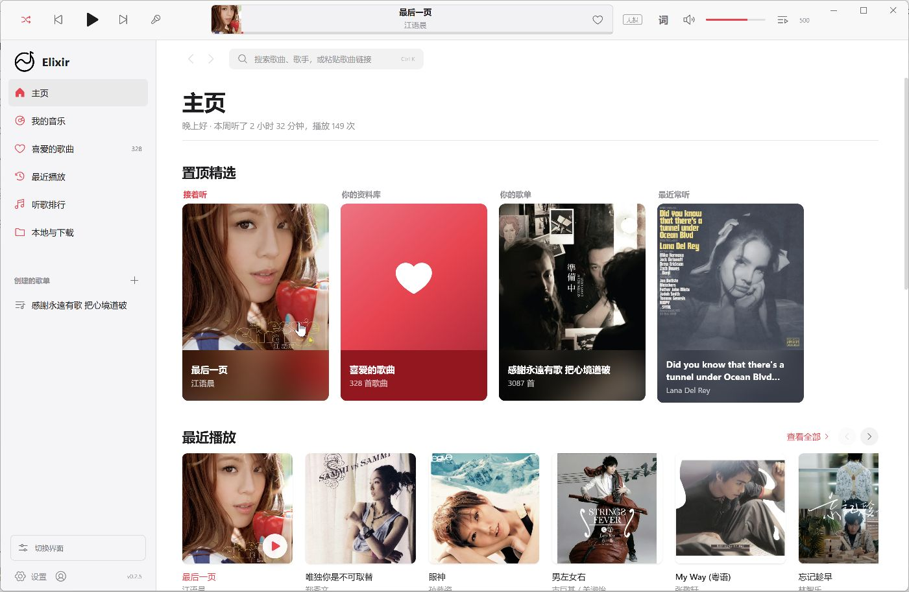
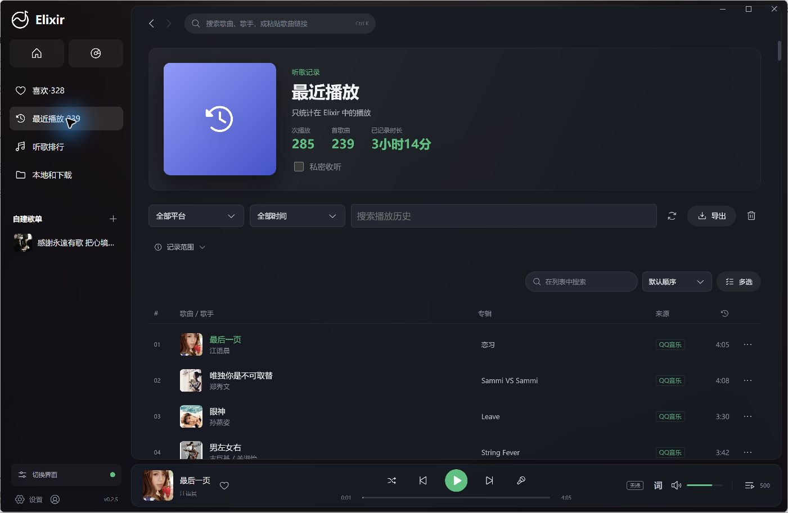

<p align="center"></p>

<h1 align="center">Elixir</h1>

<p align="center">一个可以自己拼装界面的 Windows 桌面音乐播放器。<br>用你自己的网易云音乐、QQ 音乐、Spotify 账号和本地音乐听歌。</p>

<p align="center">
  <a href="https://github.com/wqx-txdsyl/elixir-music/releases/latest"></a>
  
</p>

<p align="center"><a href="https://github.com/wqx-txdsyl/elixir-music/releases/latest">下载</a> · <a href="CHANGELOG.md">更新日志</a> · <a href="https://github.com/wqx-txdsyl/elixir-music/issues">反馈问题</a></p>

## 定位

- **界面由你决定**：界面分成“皮肤”和“组件”两层。皮肤管配色与质感，侧栏、播放栏、进度条、正在播放页、歌词、首页、音浪、背景等组件可以逐个替换、拆下或装回。
- **只接正规账号**：音源只有网易云音乐、QQ 音乐、Spotify 三个平台和本地音乐。在线歌曲通过你自己的账号、经平台官方登录和官方播放渠道播放，能听哪些歌、什么音质，由账号权益和所在地区决定。
- **不做的事**：不提供歌曲下载、不解锁会员歌曲、不接入第三方或自定义音源。其他平台暂停接入。

## 功能

### 界面

- **36 套皮肤**，分四组：
  - 国内平台风格：网易云音乐、QQ音乐、酷狗音乐、酷我音乐、汽水音乐、咪咕音乐、波点音乐
  - 海外平台风格：Spotify、Apple Music、YouTube Music、TIDAL、SoundCloud、Deezer、Amazon Music、Pandora、Bandcamp、Qobuz、KKBOX、Melon、Audiomack、Anghami
  - 经典复刻：Winamp、千千静听、iTunes、Windows Media Player、iPod Classic、foobar2000
  - Elixir 原创：极光、墨刻、晨雾、终端、报刊、新粗野、像素、蒸汽波、墨水屏
- **可拆装组件**：
  - 侧栏：完整、图标窄栏、悬浮卡片、程序坞，或拆下改成顶部导航，可放左右两侧。
  - 播放栏：底栏、顶部、悬浮胶囊、灵动岛、极简细条，也可以拆下。
  - 进度条：细线、粗条、贯通顶边、声波、歌词刻度。所有样式都会标出副歌位置，点一下就能跳到副歌。
  - 正在播放页：黑胶唱机、封面歌词、沉浸全屏、卡拉 OK、海报、磁带、iPod 转盘、CD 随身听。
  - 歌词排版：居中渐隐、左对齐大字、整块色底、竖排、提词器、单行字幕。
  - 首页：六种平台风格排法、唱片箱，以及可以自己排模块的模块化首页。
  - 另外还有音浪、背景（含封面墙），以及右侧正在播放栏、播放栏歌词、侧栏听歌时钟等附加件。
- **个性化工坊**：换皮肤和组件、一键布局预设、强调色（可跟随封面取色）、圆角、字体、列表密度、界面缩放、高对比度、导航排序与隐藏。
- **布局编辑模式**：直接在界面上点组件来换样式或拆下，拆下的组件放进托盘，随时装回，支持撤销。
- **外观方案**：保存多套方案，按白天 / 夜间自动切换；可以用分享码或文件导入导出，也支持自定义背景图和自定义 CSS。
- **命令面板**（Ctrl K）：搜索音乐、跳转页面、控制播放、切换皮肤与组件。

### 听歌

- 在已登录的平台和本地音乐里一起搜索歌曲、专辑、歌手、歌单与 MV。
- 读取平台账号里的歌单和收藏，导入本地音乐，管理自建歌单、收藏、批量操作与排序。
- 播放队列、下一首播放、最近播放、听歌排行与播放统计。
- 听歌日历：按天显示近半年的听歌时长，附连续听歌天数。
- 歌词、桌面歌词、歌词配色与固定窗口。
- 网易云音乐和 QQ 音乐的 MV 可以在 Elixir 里直接播放。
- 关闭窗口后在托盘后台继续播放。

## 支持的平台

| 平台 | 登录方式 | 播放方式 | 首页推荐 |
| --- | --- | --- | --- |
| 网易云音乐 | 网易云音乐 App 扫码 | 应用内播放 | 每日推荐、私人 FM、推荐歌单、新碟上架 |
| QQ 音乐 | 官方页面，QQ 或微信登录 | 应用内播放 | 雷达、猜你喜欢 |
| Spotify | 网页登录，或粘贴 sp_dc Cookie | 应用内的 Spotify 网页播放器，免费账号也可以用 | Spotify 官方页面推荐 |
| 本地音乐 | 无需登录 | 应用内播放 | — |

- 在「账号与会员」页连接账号。全平台搜索只查询已登录的平台。
- 皮肤和音源互相独立：选了某个平台风格的皮肤，并不代表接入了这个平台。
- 暂停接入的平台不会出现在账号、搜索和首页推荐里，之前收藏的歌曲照常保留。

## 下载与使用

从 [GitHub Releases](https://github.com/wqx-txdsyl/elixir-music/releases/latest) 下载 Windows 便携版 `Elixir-<版本>-Windows.exe`，放到一个可写的目录里运行，例如 `D:\Programs\Elixir`。

程序会在旁边创建 `MusicPlatformData` 目录，用来保存设置、音乐库和加密后的账号信息。更新时先退出 Elixir，替换程序文件，保留原来的 `MusicPlatformData` 即可；从 0.x 升级会沿用原来的界面风格。

## 截图

### Apple Music 风格



### QQ 音乐风格



## 从源码运行

基于 Electron、React 和 Python FastAPI。需要 Windows x64、Node.js 和 Python 3.11 及以上版本：

```powershell
npm ci
python -m pip install -r requirements.txt
npm run prepare:playback
npm run build
npm start
```

`prepare:playback` 会下载并校验固定版本的 Castlabs Electron。开发数据默认保存在本地 `data/` 目录，不会进入 Git。

## 打包

```powershell
python -m pip install -r requirements-build.txt
npm run pack
```

输出目录是 `release/elixir-candidate/win-unpacked`。`npm run dist` 会额外做媒体签名并生成便携版，需要打包者自己配置 Castlabs EVS 账户，签名配置和密码不随源码分发，详见 [构建说明](docs/build.md)。

## 目录

| 目录 | 内容 |
| --- | --- |
| `frontend/` | React 界面、皮肤、组件与静态图标 |
| `backend/` | 本地服务、平台适配、SQLite 音乐库 |
| `desktop/` | Electron 主进程、Spotify 网页播放器、托盘与品牌资源 |
| `scripts/` | 运行环境准备与打包脚本 |
| `docs/` | 构建说明、平台标识说明与 Apple Music 接入调研 |

## 反馈与贡献

反馈问题时请附上版本号、复现步骤和截图，并隐去账号信息。不要把 `MusicPlatformData`、登录 Cookie 或签名凭据发到 Issue 或提交进仓库。

修复和功能改进欢迎提交 Pull Request；较大的改动建议先开 Issue 讨论。

## 声明

- 文中提到的音乐平台和播放器名称、商标归各自所有者。同名皮肤只是对其设计风格的致敬，Elixir 与这些平台没有关联，也没有得到它们的认可。
- Elixir 不存储、不分发任何音乐内容。在线播放使用你自己的账号，请遵守各平台的用户协议。
- 本仓库尚未授予开源许可证；第三方依赖遵循各自的许可证。
